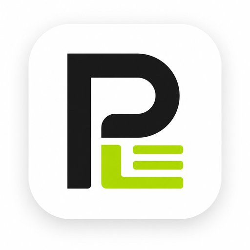
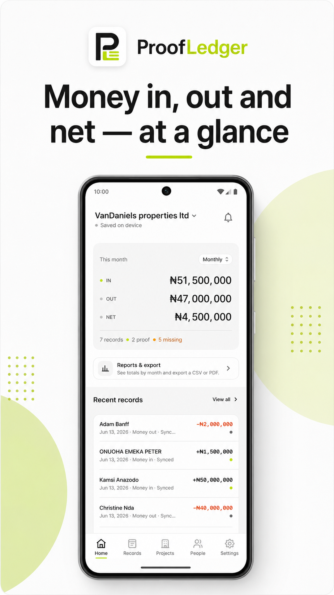
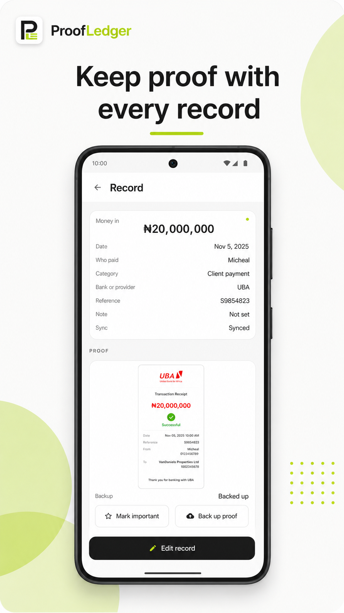
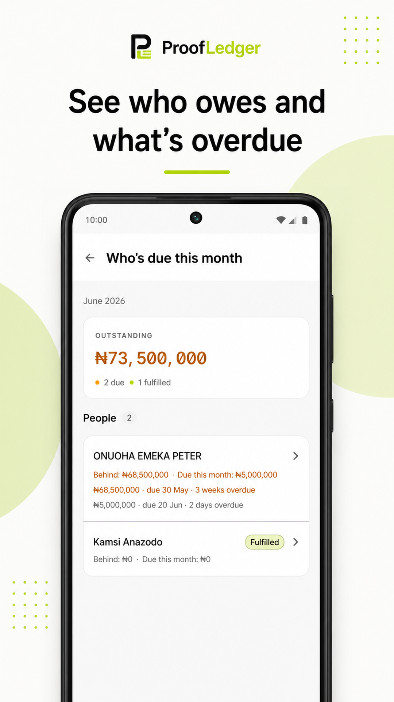
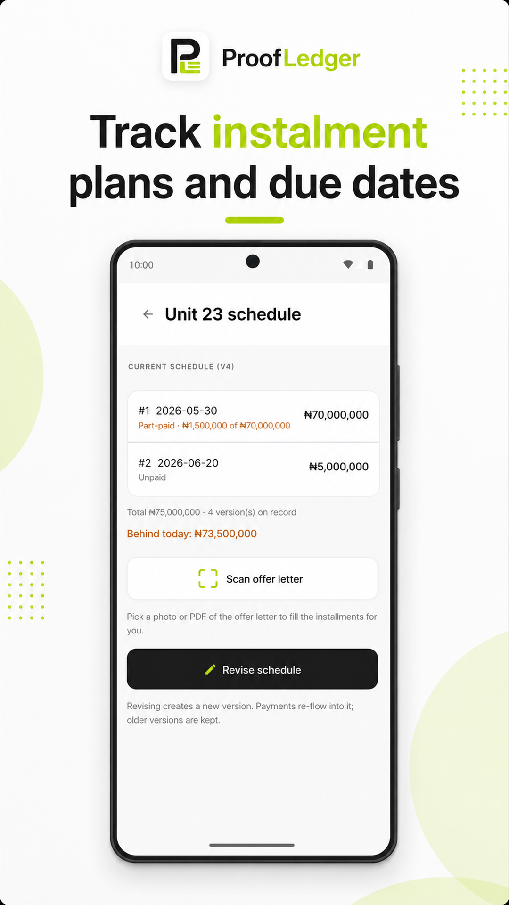
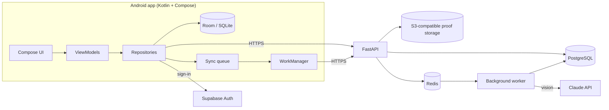

<p align="center">
  
</p>

<h1 align="center">ProofLedger</h1>

<p align="center">
  <strong>Turn payment screenshots into a searchable business ledger.</strong><br/>
  An offline-first Android app + FastAPI backend for small businesses that track money through WhatsApp screenshots, paper notes and memory.
</p>

<p align="center">
  Kotlin · Jetpack Compose · Room · WorkManager · FastAPI · PostgreSQL · Redis · Supabase Auth · Claude vision
</p>

<p align="center">
  
  
  
  
</p>

## The problem

Many small businesses get paid by bank transfer and keep the "receipt" as a screenshot in a chat thread. When they need to know who has paid, who is behind, or what came in this month, someone scrolls through hundreds of images and adds it up by hand.

The first target is **instalment-based house-sale businesses**: they sell units on offer-letter payment plans and need to know, without flipping through documents, who is due this month and who is behind.

## What it does

- **Capture:** share a payment screenshot or PDF offer letter straight into the app from any chat app.
- **Draft with AI, confirm as a human:** a server-side Claude vision model drafts the amount, date, counterparty and reference. The user always reviews and edits before anything is saved.
- **Keep the proof:** the original image stays attached to every record and is backed up.
- **Catch duplicates:** warning-only duplicate detection compares proof hashes, references and amount/date/counterparty signals.
- **Track projects:** houses, units, buyers, instalment schedules, arrears ("who's due this month") and money out per project.
- **Report:** weekly/monthly summaries, CSV export offline and PDF export from the backend.
- **Work offline:** everything is usable with no signal; changes sync when the connection returns.

## How it works



**Key engineering decisions**

| Decision | Why |
| --- | --- |
| **Offline-first:** the local Room database is the source of truth on the device | Users are often on poor connections; the app must never block on the network. |
| **Background sync in dependency order** | Data that other records depend on syncs first, so nothing reaches the server before what it references. Failed work stays queued and retryable, with clear user-facing errors. |
| **AI drafts, humans confirm** | Financial records can't be wrong silently. AI fills in a draft; nothing is saved until the user reviews it. |
| **Extraction runs in a background worker**, not in the request | Vision calls are slow; the API stays fast and jobs retry independently. |
| **Duplicate detection warns, never blocks** | Two genuinely identical payments can exist; the user decides. |
| **Audit trail** of financial create/edit/delete events | Users can see the edit history behind every number. |

## Testing and quality

- **400+ automated tests:** 238 backend (pytest) and 176 Android unit tests.
- Every change shipped through a branch and pull request (~50 PRs).
- Database migrations with Alembic (backend) and versioned Room schemas (Android).
- Production monitoring with Sentry (errors) and PostHog (product analytics).
- Upload rate-limiting, currency allowlist, search escaping and CORS hardening on the API.

## Status

- **v1 deployed to production in June 2026** and verified end to end (create business → record money in/out → attach proof → sync).
- Since v1: project-based tracking (houses, buyers, instalment schedules), PDF offer-letter scanning and offer-letter duplicate detection.
- Android release prepared for Google Play testing.

## Fresh-Machine Setup

Tested commands for going from a clean `git clone` to a running stack. See
`docs/mobile-development-things-to-know.md` for deeper notes and
troubleshooting; this section is the minimal happy path.

### Prerequisites

- Git
- Docker Desktop (running before the backend commands below)
- Python 3.11 or newer + [uv](https://docs.astral.sh/uv/)
- JDK 17 (Android Gradle Plugin 8.x requirement)
- Android Studio (Iguana or newer) or the standalone Android command-line
  tools + an emulator image (API 34+ recommended)

### Backend

```powershell
git clone <repo-url> payment-proof-tracker
cd payment-proof-tracker
Copy-Item backend\.env.example backend\.env   # then edit secrets as needed
docker compose up -d                          # Postgres + Redis
cd backend
uv sync                                       # install Python deps
uv run alembic upgrade head                   # apply migrations
uv run pytest                                 # verify suite passes
uv run uvicorn app.main:app --reload          # start the API on :8000
```

Verify in a second shell:

```powershell
Invoke-WebRequest http://localhost:8000/health -UseBasicParsing
```

### Android

```powershell
cd android
Copy-Item local.properties.example local.properties   # if the file exists
# Otherwise create android\local.properties with at minimum:
#   sdk.dir=<path-to-your-Android-SDK>
#   API_BASE_URL=http://10.0.2.2:8000/
.\gradlew.bat :app:testDebugUnitTest                  # verify unit tests pass
.\gradlew.bat :app:assembleDebug                      # build the APK
```

The emulator must reach the backend at `10.0.2.2:8000` (not `localhost`).
For a physical device on the same Wi-Fi, point `API_BASE_URL` at your
machine's LAN IP and ensure the firewall allows port 8000.

### What to run after each pull

```powershell
docker compose up -d                          # restart containers if stopped
cd backend; uv sync; uv run alembic upgrade head
cd ..\android; .\gradlew.bat :app:testDebugUnitTest
```

## Docs

See [`docs/master-plan.md`](docs/master-plan.md) for the full product and architecture plan.
See [`docs/mobile-development-things-to-know.md`](docs/mobile-development-things-to-know.md) for local mobile/backend development notes.
